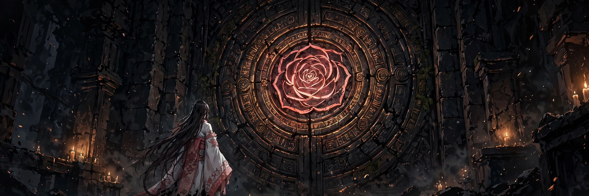

# Roseford

## 18+ — Adults Only

This game contains adult content. It is intended only for players 18 and older.

### Content notes

- Hypnotic wards that tune the heroine are the central mechanic — mind control is the dungeon's weapon, and its price
- Corruption is a measured state that never decreases within a run: taking tuning is how she buys power and memory, and it cannot be un-spent
- Her face state changes with her corruption band, from composed through edge and peak to daze

All characters depicted are adults.

## A dungeon RPG where a resurrected shrine maiden descends a sealed dungeon whose wards tune her — corruption is her power curve, her memory, and her price.

<a href="https://github.com/NTRanch/roseford">GitHub</a> · <a href="https://github.com/NTRanch/roseford/blob/main/LICENSE.md">License</a> · <a href="https://ntranch.itch.io">itch.io studio page</a>

## Built with

  

## What you do

Isolde, keeper-maiden of the Roseford shrine, wakes in the chapel above the seal — alive again, with no memory of her death or of the rite that sealed the dungeon a generation ago. The seal is failing. You take her down: the Chapel hub above, five floors below, each a compact run of chambers ending at a ward-boss and its seal.

The ward-bosses do not guard their floors by killing intruders. They tune them. Every fight runs on two axes at once — her HP, and her Tuning Exposure. When the Exposure fills, the boss tunes her: her Corruption rises, her face shifts a band, and the boss's pressure quickens. Winning tunes her too; a broken seal floods its ward into her as it falls. There is no version of going deeper that leaves her unchanged.

## Features

- One master state: Corruption C ∈ [0, 1000], monotonic within a run — no shop sells it back, no shrine washes it; the only reset is the confession rite, which ends the run with honour
- Five floors, five wards, five tuning methods — rhythm, gaze, voice, self-image, and the plain truth of the Rose Floor — each capped at 200 C per run, so the deep bands are unreachable early by construction
- Two prayer kits pulling opposite ways: six pure prayers that weaken as she descends, and five Invokes, one gifted by each ward, that scale with her corruption
- Twelve memory fragments gated behind tuning: revelation is arithmetic — a purity run ends at 10 or 11 fragments and cannot read the whole truth
- The Chapel Record persists across runs: fragments found, band crossings, every Tuning taken and from whom, endings reached
- Two complete endings on identical footing — reseal the door having chosen the not-knowing, or take the Rosekeeper's seat with the record read whole

## Media

- Header art: [`assets/brand/header.png`](../assets/brand/header.png) (above)

## Status

**Design stage — no playable build exists yet.** This repo holds the scaffold: the design of record (`DESIGN.md`), the planning book (`book/`), baseline configuration, and brand art. Roseford is entry 15 of the Torogao Jam Program (Wave E — Systems); its build is a later rung, gated on this design and the week-15 preflight, and the jam clock starts on the Owner's word. Delivery, when built, is one self-contained `index.html`. This GitHub page is the game's home while itch project slots are unavailable.

## Credits

A Nice Thoughts Ranch game.

Made with Rust; engine of record is macroquad (see the planning book's engine research).
